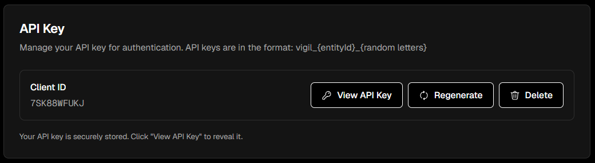
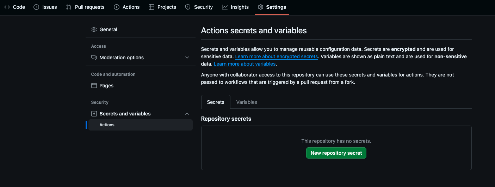

#  Vigilnz GitHub Action

## Overview
The **Vigilnz Security Scan Action** helps developers automatically check their applications and repositories for vulnerabilities during CI/CD.
It supports multiple scan types:
- **SCA** → Software Composition Analysis
- **SBOM** → Software Bill of Materials generation
- **SAST** → Static Application Security Testing
- **IAC SCAN** → Infrastructure as Code — checks configuration files (Terraform, Kubernetes, etc.) for misconfigurations.
- **SECRET SCAN** → Secret Detection — finds hardcoded credentials, API keys, and sensitive information in source code.
- **DAST** → Dynamic Application Security Testing — tests running web applications for security vulnerabilities.
- **CONTAINER SCAN** → Container Image Scanning — analyzes container images for vulnerabilities and misconfigurations.


This action makes it easy to integrate Vigilnz scanning into your GitHub workflows.

---

## Usage

To use the Vigilnz Security Scan Action, follow these steps in order:

1. [Generate API Key from Vigilnz Security](#api-key-generation).
2. [Store the API key securely in GitHub Secrets](#store-the-api-key-securely-in-github-secrets).
3. [Add the action to your GitHub workflow](#add-the-action-to-your-github-workflow).

## API Key Generation

### To generate your Vigilnz API Key:

1. Login to the <a href="https://vigilnz.com/" target="_blank">Vigilnz</a> application.
2. Navigate to **Settings → API Keys**.
3. Click **Generate New Key** or **View API Key** (if it exists).
4. Copy the API Key and store it securely.



This key authenticates the action as your Vigilnz account — it carries whatever scan
permissions and plan limits your account already has. It is not scoped per-repository;
treat it the same as any other account credential and never commit it to the repository.

## Store the API key securely in GitHub Secrets

1. Go to your repository **Settings → Secrets and variables → Actions**.
2. Click **New repository secret**.
3. Add:
  - **Name**: VIGILNZ_API_KEY
  - **Value**: your Vigilnz API key



## Add the action to your GitHub workflow:

```yaml
name: Security Scan

on:
  push:
    branches: [ main ]
  pull_request:

jobs:
  scan:
    runs-on: ubuntu-latest
    steps:
      - uses: actions/checkout@v4

      - name: Run Vigilnz Scan
        uses: vigilnz/vigilnz-scan-action@v1
        with:
          vigilnzApiKey: ${{ secrets.VIGILNZ_API_KEY }}
          scanTypes: "SCA,SBOM,SAST,SECRET SCAN,IAC SCAN"
          projectName: "my-project"

```

## Inputs

### Core inputs

`vigilnzApiKey` and `scanTypes` must be set on every run — the action fails immediately
if either is missing.

| Name          | Accepted values / purpose |
|---------------|----------------------------|
| vigilnzApiKey | Your Vigilnz API key. Always read from a GitHub secret (`${{ secrets.VIGILNZ_API_KEY }}`), never hardcoded in the workflow. |
| scanTypes     | Comma-separated, case-insensitive list of scan types to run this step. Accepted values: `sca`, `sbom`, `sast`, `secret` (or `secret scan`), `iac` (or `iac scan`), `dast`, `container` (or `container scan`). Example: `"sca,sast,secret"`. |
| projectName   | Optional. A name shown for this run in the Vigilnz UI, so you can tell which project/service a scan belongs to. When omitted, the scan is still created, just unlabeled. |
| repoAccessToken | Optional. A fallback access token for scanning a **private** repository (e.g. `${{ secrets.GITHUB_TOKEN }}` or a PAT with read access). See [Scanning a private repository](#scanning-a-private-repository) below. |

The scanned **branch** needs no input — the action reads it from the workflow context
(`GITHUB_HEAD_REF` on `pull_request` events, otherwise `GITHUB_REF_NAME`) and sends it with the
scan so results are grouped under the right branch in the Vigilnz UI, and so it is returned in
this run's own outputs — see [Outputs](#outputs).

### Scanning a private repository

For a private repository, Vigilnz needs a credential to read its metadata. The action tries,
in order:

1. **A GitHub integration already connected to your Vigilnz account** that covers this repo —
   nothing to configure in the workflow when this is set up.
2. **`repoAccessToken`**, used only as a fallback when no such integration is found. The
   repository's own `${{ secrets.GITHUB_TOKEN }}` (already scoped to this repo, auto-expiring)
   works for same-repo scans; use a personal access token with read access instead if you need
   to scan a different private repository.

```yaml
      - uses: vigilnz/vigilnz-scan-action@v1
        with:
          vigilnzApiKey: ${{ secrets.VIGILNZ_API_KEY }}
          scanTypes: "sca,sast,secret"
          repoAccessToken: ${{ secrets.GITHUB_TOKEN }}
```

`repoAccessToken` is read as a GitHub Actions secret, masked in the workflow log, and used only
in-memory to resolve this one scan request — Vigilnz never stores it. A public repository, or a
private one already covered by a connected integration, needs no `repoAccessToken` at all.

### Monorepo Path Scoping

Both inputs below are optional. By default the whole repository is scanned. In a monorepo you
usually want a pipeline to scan only the service it builds. Both inputs take a comma-separated
list of paths **relative to the repository root**.

| Name         | Accepted values / purpose |
|--------------|----------------------------|
| includePaths | Comma-separated repo-relative paths. Only these paths are scanned. Leaving it empty (the default) scans the whole repository. |
| excludePaths | Comma-separated repo-relative paths. These are skipped. Applied *after* `includePaths`, so an exclusion always wins over an inclusion that would otherwise cover it. |

```yaml
- name: Scan only the backend service
  uses: vigilnz/vigilnz-scan-action@v1
  with:
    vigilnzApiKey: ${{ secrets.VIGILNZ_API_KEY }}
    scanTypes: "sca,secret"
    includePaths: "backend/,shared/"
    excludePaths: "backend/API/tests/"
```

A path matches a file when it equals the path or is one of its parent directories, on segment
boundaries — so `backend` matches `backend/api.js` but never `backend-legacy/api.js`. Trailing
slashes are optional. Absolute paths and any path containing `..` are rejected and fail the
step before a scan is queued (up to 32 entries per list, 512 characters each).

Applies only to the scan types that actually read repository files (`sca`, `sbom`, `sast`,
`iac`, `secret`). `dast` targets a URL and `container` targets an image, so both ignore these
inputs; a run consisting only of those types logs a warning and scans as normal.

> **SCA note:** an `sca` scope must contain a dependency manifest or lock file. Scoping to a
> directory that has neither — for example a workspace member whose lock file lives at the
> repository root — reports no dependencies. The worker log records
> `path scope matched 0 dependency manifests` when this happens.

### Wait & Gating Inputs

All inputs below are optional. By default the action **queues** the scans and finishes
immediately — it does not wait for results. Set `waitForCompletion: true` to block the job
until every scan finishes, read the findings back, and optionally fail the build on severity.

| Name                | Accepted values / purpose |
|---------------------|----------------------------|
| waitForCompletion   | `true` or `false`. Default `false` (queue and exit immediately). Set `true` to block the job until every queued scan reaches a terminal state (`complete`, `error`, or `timed_out`). |
| timeoutMinutes      | Whole number, clamped to 1–360. Default `30`. Maximum minutes to wait when `waitForCompletion: true`. Only meaningful together with `waitForCompletion`. |
| pollIntervalSeconds | Whole number, clamped to 5–300. Default `15`. Seconds between scan-status polls. Only meaningful together with `waitForCompletion`. |
| failOnSeverity      | One of `critical`, `high`, `medium`, `low`, `none`. Default `none` (never fails on findings). Fails the job when findings exist at or above this severity. Requires `waitForCompletion: true` — ignored otherwise. |
| failOnScanError     | `true` or `false`. Default `true`. Fails the job when a scan itself errors or times out. Only applies when `waitForCompletion: true`. |

### Outputs

Outputs are always set, including in queue-only mode (`waitForCompletion: false`). Severity
counts are `0` unless `waitForCompletion: true` actually read the results back.

| Name           | Description                                                             |
|----------------|---------------------------------------------------------------------------|
| scanTargetIds  | Comma-separated scan target IDs created by this run                       |
| scanStatus     | `pending` (queue-only), `complete`, `error` or `timed_out`                |
| repoUrl        | Repository URL that was scanned                                           |
| branch         | Branch these scans were triggered for — the same branch resolution described in [Core inputs](#core-inputs) above, echoed back here so a downstream step doesn't have to re-derive it. Empty string if it could not be resolved. |
| criticalCount  | Total critical findings across all scans                                  |
| highCount      | Total high findings across all scans                                      |
| mediumCount    | Total medium findings across all scans                                    |
| lowCount       | Total low findings across all scans                                       |
| totalFindings  | Total findings across all scans                                           |
| resultsJson    | JSON array of per-scan outcomes — one object per scan type queued. Same schema whether or not `waitForCompletion` was set (see table below), so a downstream step or saved artifact never has to special-case queue-only runs. |

#### `resultsJson` entry fields

| Field              | Description |
|--------------------|-------------|
| scanTargetId       | The scan target ID created for this scan type — use this to look the scan up via the Vigilnz API. |
| scanType           | The scan type this entry is for, as sent to the API (`cve` for SCA, `sbom`, `sast`, `secret`, `iac`, `dast`, `container`). |
| branch             | The same branch as the top-level `branch` output, repeated on every entry so a single entry is self-contained when read out of context (e.g. from a saved artifact). |
| status             | `pending` (queue-only), `complete`, `error`, or `timed_out`. |
| percent            | Last known progress percentage (0–100). On `error`/`timed_out`, this is however far the scan got before polling gave up — not just `0` — so you can tell "failed at the start" from "failed near the end". Always `0` in queue-only mode, since the scan hasn't started being polled. |
| message            | Human-readable status detail from the platform (e.g. `"Scan complete"`), or this action's own explanation when polling itself failed (e.g. `"Status endpoint unreachable"`, `"Timed out waiting for scan to complete"`). In queue-only mode this is a fixed `"Queued — not waiting for completion"`. |
| scanId             | The completed scan's own ID, used to fetch findings and build a reference to this specific scan run. `null` until the scan actually reaches `complete` (including in queue-only mode, where it is always `null`). |
| summary            | `{ critical, high, medium, low, totalFindings }` for this scan type. All `0` unless this entry's `isSummaryAvailable` is `true`. |
| isSummaryAvailable | `true` once the severity counts above were actually read from the platform. `false` in queue-only mode, or when reading the summary for a completed scan itself failed — this is NOT the same as "zero findings", so always check it before trusting a `0` in `summary` for an audit record. |

```yaml
- name: Report
  if: always()
  run: |
    echo "Branch:   ${{ steps.vigilnz.outputs.branch }}"
    echo "Critical: ${{ steps.vigilnz.outputs.criticalCount }}"
    echo "High:     ${{ steps.vigilnz.outputs.highCount }}"
    echo "Total:    ${{ steps.vigilnz.outputs.totalFindings }}"

- name: Save full per-scan results as a build artifact
  if: always()
  run: echo '${{ steps.vigilnz.outputs.resultsJson }}' > vigilnz-results.json

- uses: actions/upload-artifact@v4
  if: always()
  with:
    name: vigilnz-scan-results
    path: vigilnz-results.json
```

### DAST Scan Inputs

Both inputs below are required together, but **only when `dast` is included in `scanTypes`** —
the step fails immediately if one is set without the other. Neither applies to any other scan
type.

| Name          | Accepted values / purpose |
|---------------|----------------------------|
| dastScanType  | `spider` (crawl the target and catalog pages/links only, no active attacks) or `active` (crawl, then actively probe the discovered pages for vulnerabilities). |
| dastTargetUrl | The full URL of the already-running web application to test, e.g. `https://staging.example.com`. The app must be reachable from Vigilnz's scanning infrastructure — no GitHub secret or token is needed for a publicly reachable target; this action does not support passing authentication headers to the target itself. |

#### Run a DAST scan

```yaml
with:
  vigilnzApiKey: ${{ secrets.VIGILNZ_API_KEY }}
  scanTypes: "DAST"
  dastScanType: "active"
  dastTargetUrl: "https://example.com"
  projectName: "web-application"
```

### Container Scan Inputs

All inputs below apply **only when `container` is included in `scanTypes`**. `containerImage`
and `containerProvider` are always required together for a container scan; which of the
remaining inputs are required depends on the registry, covered provider-by-provider below.

| Name                  | Accepted values / purpose |
|-----------------------|----------------------------|
| containerImage        | Full image reference to scan, e.g. `nginx:latest` or `myorg/myapp:1.0.0`. |
| containerProvider     | Which registry the image lives in: `dockerhub` (Docker Hub), `aws-ecr` (Amazon ECR), `github` (**GitHub Container Registry / GHCR**), `gitlab` (**GitLab Container Registry**), `google` (Google Container Registry / Artifact Registry), `azure` (Azure Container Registry / ACR), `quay` (Quay.io). |
| containerRegistryType | Registry sub-type, only required by providers that have more than one shape — see each provider's table below for its accepted values. |
| containerRegistryUrl  | The registry's own host/URL. Only needed for the private/self-hosted sub-types called out below (e.g. a private ECR or ACR registry, or Google Artifact Registry). |
| containerAuthType     | `none` (no credentials — public image), `token` (a single bearer token), or `username-password`. Which of these a given provider accepts is listed in its table below. |
| containerToken        | Access token for `containerAuthType: token`. What kind of token, and what permission it needs, differs per provider — see below. Always read from a GitHub secret. |
| containerUsername     | Username for `containerAuthType: username-password`. |
| containerPassword     | Password or access token used as the password for `containerAuthType: username-password`. Always read from a GitHub secret. |

#### Docker Hub (`dockerhub`)

| Image visibility | containerAuthType | Required credentials |
|---|---|---|
| Public | `none` (or omit) | None. |
| Private | `username-password` | `containerUsername` + `containerPassword`. Use a [Docker Hub access token](https://docs.docker.com/security/for-developers/access-tokens/) as the password, not your account password. |

```yaml
# Public image
with:
  vigilnzApiKey: ${{ secrets.VIGILNZ_API_KEY }}
  scanTypes: "CONTAINER SCAN"
  containerImage: "nginx:latest"
  containerProvider: "dockerhub"
  containerAuthType: "none"
```

```yaml
# Private image
with:
  vigilnzApiKey: ${{ secrets.VIGILNZ_API_KEY }}
  scanTypes: "CONTAINER SCAN"
  containerImage: "myorg/myapp:1.0.0"
  containerProvider: "dockerhub"
  containerAuthType: "username-password"
  containerUsername: ${{ secrets.DOCKERHUB_USERNAME }}
  containerPassword: ${{ secrets.DOCKERHUB_PASSWORD }}
```

#### Amazon ECR (`aws-ecr`)

`containerRegistryType` is always required: `ecr-public` or `ecr-private`. `ecr-private`
additionally requires `containerRegistryUrl` (the registry host, e.g.
`123456789012.dkr.ecr.us-east-1.amazonaws.com`) and `containerAuthType: token` with
`containerToken` set to a short-lived ECR authorization token (e.g. the output of
`aws ecr get-login-password`, run in an earlier step using an IAM principal with at least
`ecr:GetAuthorizationToken` and `ecr:BatchGetImage`/`ecr:GetDownloadUrlForLayer` on the
repository).

```yaml
with:
  vigilnzApiKey: ${{ secrets.VIGILNZ_API_KEY }}
  scanTypes: "CONTAINER SCAN"
  containerImage: "myapp:latest"
  containerProvider: "aws-ecr"
  containerRegistryType: "ecr-private"
  containerRegistryUrl: "123456789012.dkr.ecr.us-east-1.amazonaws.com"
  containerAuthType: "token"
  containerToken: ${{ secrets.AWS_ECR_TOKEN }}
```

#### GitHub Container Registry — GHCR (`github`)

`containerAuthType: token` with `containerToken` set to a token carrying the `read:packages`
scope. Either the workflow's own `GITHUB_TOKEN` — in which case the workflow (or job) needs
`permissions: packages: read` — or a personal access token with `read:packages` works.

```yaml
with:
  vigilnzApiKey: ${{ secrets.VIGILNZ_API_KEY }}
  scanTypes: "CONTAINER SCAN"
  containerImage: "ghcr.io/myorg/myapp:latest"
  containerProvider: "github"
  containerAuthType: "token"
  containerToken: ${{ secrets.GITHUB_TOKEN }}
```

#### GitLab Container Registry (`gitlab`)

`containerAuthType: token` with `containerToken` set to a GitLab access token (personal,
project, group, or deploy token) carrying the `read_registry` scope.

```yaml
with:
  vigilnzApiKey: ${{ secrets.VIGILNZ_API_KEY }}
  scanTypes: "CONTAINER SCAN"
  containerImage: "registry.gitlab.com/myorg/myapp:latest"
  containerProvider: "gitlab"
  containerAuthType: "token"
  containerToken: ${{ secrets.GITLAB_REGISTRY_TOKEN }}
```

#### Google Container/Artifact Registry (`google`)

`containerRegistryType` is always required: `gcr` (legacy Google Container Registry) or
`artifact-registry`. `artifact-registry` additionally requires `containerRegistryUrl`.
`containerAuthType: token` with `containerToken` set to a GCP OAuth access token for a service
account granted `roles/artifactregistry.reader` (Artifact Registry) or
`roles/storage.objectViewer` (legacy GCR, which is backed by Cloud Storage).

```yaml
with:
  vigilnzApiKey: ${{ secrets.VIGILNZ_API_KEY }}
  scanTypes: "CONTAINER SCAN"
  containerImage: "gcr.io/myproject/myapp:latest"
  containerProvider: "google"
  containerRegistryType: "gcr"
  containerAuthType: "token"
  containerToken: ${{ secrets.GCP_TOKEN }}
```

#### Azure Container Registry — ACR (`azure`)

`containerRegistryType` is always required: `mcr` (Microsoft Container Registry — public
Microsoft-maintained images) or `acr-private`. `acr-private` additionally requires
`containerRegistryUrl` (e.g. `myregistry.azurecr.io`) and either `containerAuthType: token`
(an ACR access token, e.g. from `az acr login --expose-token`, which requires the `AcrPull`
role on the registry) or `containerAuthType: username-password` (an ACR admin-user or service
principal credential, also needing `AcrPull`).

```yaml
with:
  vigilnzApiKey: ${{ secrets.VIGILNZ_API_KEY }}
  scanTypes: "CONTAINER SCAN"
  containerImage: "myapp:latest"
  containerProvider: "azure"
  containerRegistryType: "acr-private"
  containerRegistryUrl: "myregistry.azurecr.io"
  containerAuthType: "token"
  containerToken: ${{ secrets.AZURE_ACR_TOKEN }}
```

#### Quay.io (`quay`)

Quay has no unauthenticated option in this action — a Robot Account is required for every
image, public or private. Use `containerAuthType: token` (Robot Account token) or
`containerAuthType: username-password` (Robot Account username + token-as-password). The
Robot Account needs at least **read** permission on the repository being scanned.

```yaml
with:
  vigilnzApiKey: ${{ secrets.VIGILNZ_API_KEY }}
  scanTypes: "CONTAINER SCAN"
  containerImage: "quay.io/myorg/myapp:latest"
  containerProvider: "quay"
  containerAuthType: "token"
  containerToken: ${{ secrets.QUAY_ROBOT_TOKEN }}
```

## Example Scenarios

### Block the PR until scans finish, and fail on high/critical:

```yaml
- name: Vigilnz Security Scan
  id: vigilnz
  uses: vigilnz/vigilnz-scan-action@v1
  with:
    vigilnzApiKey: ${{ secrets.VIGILNZ_API_KEY }}
    scanTypes: "SCA,SAST,SECRET SCAN"
    projectName: "my-application"
    waitForCompletion: true
    timeoutMinutes: 45
    failOnSeverity: high

- name: Report
  if: always()
  run: |
    echo "Branch:   ${{ steps.vigilnz.outputs.branch }}"
    echo "Critical: ${{ steps.vigilnz.outputs.criticalCount }}"
    echo "High:     ${{ steps.vigilnz.outputs.highCount }}"
    echo "Total:    ${{ steps.vigilnz.outputs.totalFindings }}"
```

### Wait for results but never fail the build (report-only):

```yaml
with:
  vigilnzApiKey: ${{ secrets.VIGILNZ_API_KEY }}
  scanTypes: "SCA,SAST"
  waitForCompletion: true
  failOnSeverity: none
  failOnScanError: false
```

### Run single scan:

```yaml
with:
  vigilnzApiKey: ${{ secrets.VIGILNZ_API_KEY }}
  scanTypes: "SCA"
```

### Run all code-based scans:

```yaml
with:
  vigilnzApiKey: ${{ secrets.VIGILNZ_API_KEY }}
  scanTypes: "SCA,SBOM,SAST,SECRET SCAN,IAC SCAN"
  projectName: "my-application"
```

### Run multiple scan types together:

Every scan type listed in `scanTypes` is queued and **runs in parallel on the Vigilnz
platform, not one after another** — SCA, SAST, DAST and Container scanning here all start at
the same time. With `waitForCompletion: true`, the action polls all of them concurrently too
(see [Wait & Gating Inputs](#wait--gating-inputs)), so the total wait is bounded by whichever
scan type takes the longest, not the sum of every scan type's duration.

```yaml
with:
  vigilnzApiKey: ${{ secrets.VIGILNZ_API_KEY }}
  scanTypes: "SCA,SAST,DAST,CONTAINER SCAN"
  projectName: "full-stack-app"
  # DAST configuration
  dastScanType: "active"
  dastTargetUrl: "https://myapp.example.com"
  # Container configuration
  containerImage: "myapp:latest"
  containerProvider: "dockerhub"
  containerAuthType: "none"
```
